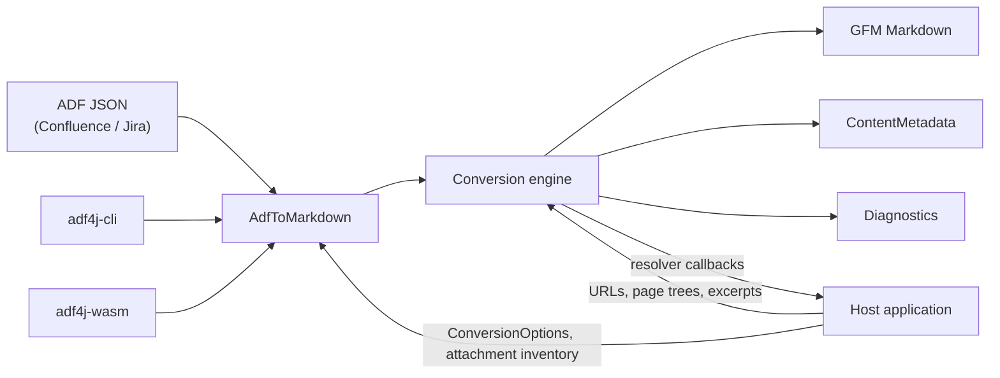
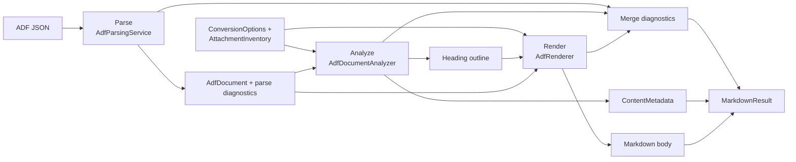
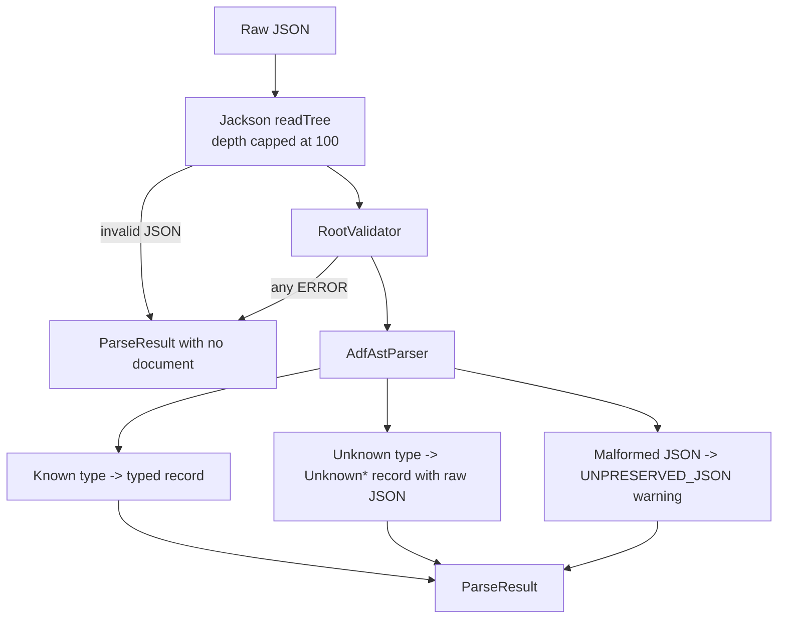

# Architecture

This document describes adf4j internals for contributors and advanced integrators. For first use, see [Getting started](./getting-started.md). For integration recipes, see the [Guide](./guide.md). For option, mapping, diagnostic, and CLI tables, see the [Reference](./reference.md).

## Design goals

1. **Correct GFM output:** Prefer valid GitHub-Flavored Markdown. Use HTML, placeholders, or diagnostics when GFM cannot express the ADF construct.
2. **Visible loss:** Separate diagnostics, conversion effects, and missing output dependencies.
3. **Safe defaults:** Treat ADF as untrusted input. Bound parser depth, sanitize URL schemes, and isolate callback failures.
4. **Small public API:** Export a focused JPMS surface and keep implementation packages internal.
5. **Cheap converters:** A converter is immutable and holds only its options, so binding one per document costs nothing. The pipeline behind it is process-wide and stateless.

## System context

adf4j is an embeddable transformation library. It accepts an ADF JSON string, a `ParseResult`, or a parsed `AdfDocument`, then returns Markdown plus metadata and diagnostics. It also writes an `AdfDocument` back to ADF JSON, whether parsed or built with `Adf`. It does not perform network, filesystem, or database I/O.

The host application owns Confluence access, CDN URLs, page hierarchy, and macro-specific data. adf4j owns parsing, analysis, Markdown rendering, escaping, and diagnostics.

## Module and package structure

| Artifact | Module | Role |
| --- | --- | --- |
| `dev.nthings:adf4j` | `adf4j-lib` | JPMS library module `dev.nthings.adf4j`. |
| `dev.nthings:adf4j-cli` | `adf4j-cli` | Command-line wrapper over the library. |
| `adf4j-wasm` | `adf4j-wasm` | Optional WebAssembly packaging under the `wasm` profile. |

Exported packages:

| Package | Contains |
| --- | --- |
| `dev.nthings.adf4j` | `AdfToMarkdown` and `AdfJson`. |
| `dev.nthings.adf4j.ast` | Public AST records. |
| `dev.nthings.adf4j.options` | `ConversionOptions`, resolver hooks, renderer hooks, enums. |
| `dev.nthings.adf4j.result` | `MarkdownResult`, `ParseResult`, `Diagnostic`, `UnresolvedResource`, `AnalysisResult`, `ValidationResult`, `ConversionEffect`, `AdfException`. |
| `dev.nthings.adf4j.metadata` | `ContentMetadata` and reference records, including `AttachmentReference`. |

Everything under `internal.*` is implementation detail. JPMS enforces that boundary. Integrators should use `AdfToMarkdown` and `AdfJson` plus the public option, result, metadata, and AST types.

## The conversion pipeline

`AdfPipeline` owns one parser, analyzer, and renderer. `AdfToMarkdown` holds one instance in a static field, so the whole process shares it, and it is stateless. Each call passes in its `ConversionOptions` and builds its own `AttachmentInventory` from them.

Phases:

| Phase | Component | Output |
| --- | --- | --- |
| Parse | `AdfParsingService` | `AdfDocument` plus parse diagnostics. |
| Analyze | `AdfDocumentAnalyzer` | Heading outline, `ContentMetadata`, lossiness diagnostics. |
| Render | `AdfRenderer` | Markdown body, unresolved resources, effects, and render diagnostics. |

Analysis precedes rendering because rendering can depend on global document facts. A table-of-contents macro needs all headings, and heading anchors must be unique before the first rendered line.

Public methods expose the pipeline at different depths:

- `AdfJson.parse()` runs parse only.
- `analyze(ParseResult|AdfDocument)` runs analyze only, on input already parsed.
- `convert(String)` and `toMarkdown()` run all three phases.
- `convert(ParseResult|AdfDocument|ExcerptDefinition)` runs analyze and render.

`convert(ParseResult)` lets callers parse once and render many times, under different converters, while preserving parse diagnostics in every render result.

## Phase 1: Parsing

The parser uses Jackson in tree mode and a hand-written recursive descent parser. It validates the document envelope before building the AST.

Robustness checks:

- Blank input yields no document and an `EMPTY_INPUT` error. Invalid JSON yields no document and `INVALID_JSON`. Neither throws.
- Nesting is capped at depth 100.
- Root validation reports missing document, invalid root type, invalid root node, invalid version, invalid content, and unsupported version.
- Unsupported version is a warning; parsing continues best effort.

### AST type model

The AST is a sealed hierarchy of immutable records:

- `AdfNode` permits `AdfDocument`, `AdfBlock`, and `AdfInline`, plus the views `AdfCard`, `AdfExtension`, and `AdfMedia`, which carry the accessors of nodes that span blocks and inlines.
- `AdfBlock` covers paragraphs, headings, lists, tables, media, cards, layout, extensions, and `UnknownBlock`.
- `AdfInline` covers text-adjacent inline constructs and `UnknownInline`.
- `AdfMark` is a separate hierarchy for marks that decorate text and media, including `UnknownMark`.
- `AdfUnknown` covers `UnknownBlock`, `UnknownInline`, and `UnknownMark`, with their `type()` and `rawJson()`.
- `BlockCard` and `EmbedCard` are both blocks and inlines, because they occur inside paragraphs too.
- Sealed `*Content` interfaces such as `PanelContent` name the node types the schema allows inside each container. They are stricter than the schema in the places it leaves open: `blockTaskItem` children after the second, and `mediaSingle` and the column count of `layoutSection` inside `bodiedSyncBlock`. `Adf` takes them as parameter types, so built documents get their nesting checked at compile time, and non-empty containers take their first child as a separate parameter. `TextMark`, `ParagraphMark`, `HeadingMark`, and `MediaMark` do the same for marks.

A record mirrors its JSON node. It stores the complete `attrs` as `Attributes`, its `content` in source order, and its `marks`, whether or not the schema allows them there. Typed accessors such as `Heading.level()` and `Table.rows()` are lenient views over that data: they coerce scalars, apply defaults, and hide off-schema children, without changing what is stored. `AdfMedia`, `AdfCard`, and `AdfExtension` define the accessors shared by several node types, such as `AdfMedia.sourceType()` for the media `type` attribute. Markdown policy stays in the renderer.

Records defensively copy collections. `Adf` is the way to construct them: its factories supply the `attrs` a node requires, and `doc` derives the required `localId`s from each node's content, so rebuilding is deterministic. `Attributes` holds plain JSON values and normalizes numbers, so equal documents compare equal and numbers beyond `long` and `double` keep every digit.

### Unknown node handling

Unknown block and inline nodes are preserved as raw JSON in `Unknown*` records. Rendering behavior is deferred to `UnknownNodePolicy`. Unknown marks have no standalone rendering form, so they are always dropped with a warning.

### Writing

`AdfJson.write` turns an `AdfDocument` back into ADF JSON with `AdfJsonWriter`, in Jackson tree mode. A parsed document writes back as the same JSON, ignoring key order, null-valued keys, and empty `attrs`, `content`, or `marks`, and comparing numbers by value. Unknown nodes and marks write their raw JSON.

The parser reports anything that guarantee cannot cover as one `UNPRESERVED_JSON` warning: non-object array elements, unknown keys, and values of the wrong JSON type on structural fields. These occur only in malformed input. Duplicate keys are the one silent exception: Jackson keeps the last value before the AST sees the node.

## Phase 2: Analysis

Analysis extracts information known before rendering:

- Heading outline and unique anchors.
- References to pages, external links, mentions, media, attachments, page-tree macros, and excerpt includes.
- Excerpt definitions.
- Unknown-node and unknown-mark diagnostics.

`AdfDocumentAnalyzer` runs one `AdfNodeWalker` pass, which hands every block and inline in document order, with its JSON Pointer, to independent visitors:

| Visitor | Purpose |
| --- | --- |
| `AdfHeadingCollector` | Builds heading text, anchors, and TOC level ranges. |
| `AdfContentMetadataExtractor` | Builds `ContentMetadata` in document order. |
| `AdfLossinessCollector` | Turns the positions of unknown nodes and marks into diagnostics. |

The walker is the single home for what a node's children are, and it follows the renderer: it skips what never renders, such as a stray child of `mediaSingle` or the marks in a code block. Metadata therefore reports what renders. A macro with a body renders a placeholder over that body and never expands, so the macro itself references nothing, though its body does. The one exception is an `excerpt`, which counts as a definition. The extractor also reads the `AttachmentInventory`, so an inventoried file's reference carries its `downloadUrl`, and an `attachments` macro references every entry.

The heading collector records all explicit anchors during the walk and reserves them before generating slugs, so a slug avoids an anchor wherever it sits in the document. Heading text covers every inline the heading renders. A resolver's or custom renderer's answer isn't known yet, so a macro counts with its fallback label.

`ContentMetadata` is a public deliverable. It lets callers build link graphs, search indexes, navigation sidebars, and fetch plans without rendering.

### Confluence layer

Confluence-specific knowledge is isolated, and all of it is internal:

- `internal.analyze.ConfluenceMacro` classifies an extension node from its type, key, and parameters. It is the single place macro parameters are normalized, and both analysis and rendering switch over its sealed cases.
- `internal.AttachmentInventory` indexes the caller's `ConversionOptions.attachments()` for one call. It is keyed by `fileId`, with a separate title index for macros, and it distinguishes an unknown inventory from an empty one.
- `internal.AttachmentReferences` resolves a macro to an attachment and classifies images from MIME types and file names.
- `internal.ConfluenceSupport` contains heuristics not tied to one macro: page IDs from URLs and link metadata, and chart titles.

The AST stays product-neutral. Page links are decided in one place, `ConfluenceSupport.pageNodeId`, shared by metadata extraction and `PageLinkResolver` rewriting.

## Phase 3: Rendering

`AdfRenderer` walks the AST with the precomputed heading outline and active `ConversionOptions`. It is stateless, and each call gets a fresh `RenderSession`.

Key state:

- `RenderSession` is what the whole traversal shares: heading outline, options, `AttachmentInventory`, the per-render sinks `MacroDiagnostics` and `RenderEvents`, `Resolvers`, and `MarkdownWriter`.
- `RenderContext(session, site, path)` is the immutable cursor. It holds the session, the `InlineSite` (`BODY`, `GFM_CELL`, `HTML_CELL`, or `HEADING`) that changes on descent and decides escaping and hard-break form, and the JSON Pointer of the node being rendered. Renderers descend through `children` and `at`, which take each pointer from the child's index in its parent's `content`, so every report locates content by position, never by object identity.
- `RenderEvents` collects what the render reports: callback failures, effects in document order, unresolved dependencies, and the lossiness of each position it observes, counted once however often the renderers reach it.
- `Resolvers` wraps every caller hook: it handles a missing hook, guards the call, and applies that hook's decline rule. Renderers record what stays unresolved after every fallback.
- `MarkdownWriter` binds the `MarkdownText` operations to the render's `escapeParentheses` value.

`BlockRenderer` is the hub. It dispatches each block and renders the simple containers itself. It builds focused delegates for lists, tables, media, macros, cards, and marks, and hands them itself so they can recurse into nested blocks. `InlineRenderer` renders inline runs. It merges adjacent text nodes whose marks render identically, compared by rendered form rather than by the marks themselves, so a run gets one set of delimiters, and it tracks whether the next node sits at a line start.

List subtrees render relative to their own starting column. Each parent list item indents its child blocks once by the width of its marker and following space, including lists inside panels, blockquotes, and expand containers. Task checkboxes are paragraph content, so their continuation indent comes from the two-character bullet prefix. HTML table lists preserve ordered-list starting numbers and render nested Markdown without inherited list indentation.

`MarkdownBlocks` joins and indents rendered blocks. Adjacent lists of the same Markdown kind are separated by an invisible `<!-- -->` comment, because blank lines alone merge them into one loose list. The check reads the rendered Markdown, not the AST, so it sees through transparent containers such as layouts and excerpts, and through every macro that expands to a list. Empty list items are retained in HTML tables so their numbering and structure survive conversion.

### GFM fallback strategy

The renderer prefers native GFM and falls back only when needed:

- Complex tables use HTML.
- Visual marks drop by default or become inline HTML with `htmlVisualMarks`.
- Missing media and attachment URLs become inert placeholders.
- Unsupported macros become placeholders with diagnostics.
- Hard breaks adapt to heading, table-cell, or body context.

The complete behavior list is in [Lossy and by-design behaviours](./reference.md#lossy-and-by-design-behaviours).

### Text and URL safety

`MarkdownText` centralizes Markdown escaping, block-marker neutralization, and code fence sizing. `CellHtmlRenderer` re-parses Markdown fragments into HTML for table cells, and `MarkdownInputCleaner` normalizes the text first.

URL destinations are scheme-sanitized before output. `htmlVisualMarks` allowlists CSS values and drops anything else. `ExtensionRenderer` and `ExcerptResolver` are exceptions because their Markdown is inserted verbatim.

## Extensibility model

`ConversionOptions` exposes functional hooks for caller-owned data:

| Hook                 | Caller supplies            |
| -------------------- | -------------------------- |
| `MediaResolver`      | Media URLs.                |
| `AttachmentResolver` | Attachment URLs.           |
| `PageLinkResolver`   | Page URLs.                 |
| `PageTreeResolver`   | Page hierarchy entries.    |
| `ExcerptResolver`    | Rendered excerpt Markdown. |
| `ExtensionRenderer`  | Custom extension Markdown. |

Hooks that throw emit `CALLBACK_FAILED` and use normal fallback. Returning `null` or a blank URL declines a resource lookup. Extension handlers return `ExtensionOutput.defer()`, `replace(markdown)`, or `header(markdown)`. Non-null answers are authoritative. `ExtensionRenderer` receives the `AdfExtension` node, and `MediaResolver` the `AdfMedia` node. The attachment inventory is data rather than a hook: `ConversionOptions.withAttachments(...)`, where `null` means unknown and a list is authoritative.

## Error handling and diagnostics

adf4j reports most problems as data:

| Type | Carries |
| --- | --- |
| `ParseResult` | Parsed document or `null`, parse diagnostics, `isSuccess()`. |
| `MarkdownResult` | Body, metadata, diagnostics, effects, and unresolved resources. |
| `Diagnostic` | Code, message, optional cause. The code fixes the severity. |

Severity meanings:

- `INFO`: non-lossy note.
- `WARNING`: content changed or dropped.
- `ERROR`: conversion failed or produced an empty body.

`MarkdownResult.hasWarnings()` reports warnings independently of success. Render events collect conversion effects and unresolved dependencies. `UnknownNodePolicy.FAIL` returns a failed result; the internal abort is caught at the pipeline boundary.

## Concurrency and lifecycle

`AdfToMarkdown` is immutable and thread-safe. An instance is just its bound options over the one static `AdfPipeline`. `AdfJson` likewise holds one parser and one writer. The pipeline, parser, analyzer, and renderer are stateless, and per-call mutable state, such as a `RenderSession`, is created fresh and never shared.

Recommended lifecycle:

1. Create a converter with `AdfToMarkdown.create()` or `AdfToMarkdown.with(options)` whenever options vary, typically per document. There is nothing to build beyond the instance itself.
2. Share a converter freely across threads when its options fit.
3. To render one document under several option sets, parse once with `AdfJson.parse()` and pass the `ParseResult` to each converter.

## Dependencies and packaging

The library targets JDK 25 and uses:

| Dependency | Purpose |
| --- | --- |
| Jackson | JSON tree reading and writing. |
| CommonMark plus GFM extensions | Markdown parsing and HTML conversion for table fallback, and heading slugs. |
| jsoup | HTML table construction and serialization. |
| JSpecify | Nullness annotations. |
| SLF4J | Logging, especially callback failures. The CLI turns it off unless `-v` is set. |

`adf4j-cli` is a thin wrapper built on [aesh](https://aeshell.github.io/). Commands are annotated classes; the aesh annotation processor generates command metadata and field accessors at compile time (plus the matching `META-INF/native-image` configs), so command parsing stays reflection-free in the native image. Jackson runs in tree mode. Release artifacts are native executables plus the optional WASM build. The CLI jar is not a fat jar.

## Key design decisions

| Decision | Rationale | Trade-off |
| --- | --- | --- |
| Parse, analyze, render pipeline | Rendering needs global heading and metadata facts. | One extra tree traversal. |
| Sealed AST records | Compile-time exhaustiveness and immutable data. | Adding a node type touches exhaustive switches. |
| Unknown nodes preserved | Forward compatibility with newer ADF. | Larger public AST surface. |
| Records keep raw `attrs` behind typed accessors | Lossless by construction, with one source of truth. | Accessors coerce on each read. |
| Wide `AdfBlock`/`AdfInline` children | Off-schema input stays renderable. | Record constructors accept any nesting. |
| `Adf` factories typed by sealed `*Content` and mark interfaces derived from the schema | The compiler enforces nesting and marks. | Attribute ranges and context rules, such as alignment inside a panel, stay unchecked. `List` overloads check required children at runtime. |
| `localId`s derived per node in `doc` | Rebuilt documents write the same JSON, and an item's id ignores its state and other items. A hash of the whole document would change every id on any edit. | `doc` and `append` rebuild the tree, editing an item changes its id, and a list's id depends on its position. |
| `withX` methods on records for optional attributes | Immutable, discoverable, and consistent with `ConversionOptions`. | Only common attributes have one; the rest go through `Attributes.with`. |
| One analysis walk with visitors | Metadata, outline, and lossiness share traversal cost. | Visitors must stay independent, and the walker must track what the renderer renders. |
| List separation reads rendered Markdown | It sees through transparent containers and macros that expand to lists. | It depends on the output's line shape, not the AST. |
| Diagnostics as data | Callers can inspect quality without catching exceptions. | Callers must check `hasWarnings()` or severity. |
| Guarded resolver callbacks | I/O and environment state stay in the host application. | Callers must implement resolvers for real URLs and page trees. |
| JPMS encapsulation | Stable public API over changeable internals. | Internals are unavailable to integrations. |
| Immutable converter over a shared stateless pipeline | Thread-safe, and cheap enough to bind one per document, which keeps one way to pass options. | No per-call overloads: a call with different options needs another converter. |
